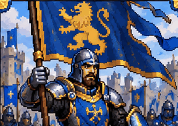
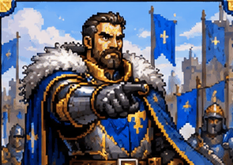
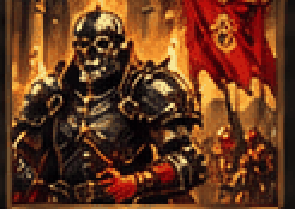

<p align="center">
  
</p>

<h1 align="center">AUCTIONHAMMER</h1>
<p align="center"><strong>Jedna plansza. Pięć jednostek. Każda decyzja ma znaczenie.</strong></p>
<p align="center">Taktyczna, turowa gra karciana fantasy dla jednego gracza przeciwko komputerowi.<br />Buduj armię, rozwijaj karty i licytuj rzadkie jednostki w średniowiecznym świecie.</p>

<p align="center">
  <a href="https://github.com/MateuszBock0/AuctionHammer/releases/latest"><strong>POBIERZ GRĘ NA WINDOWS</strong></a>
  &nbsp;·&nbsp;
  <a href="docs/PLAYER_GUIDE.md">Jak grać?</a>
  &nbsp;·&nbsp;
  <a href="CHANGELOG.md">Co nowego?</a>
  &nbsp;·&nbsp;
  <a href="https://github.com/MateuszBock0/AuctionHammer/issues/new/choose">Zgłoś problem</a>
</p>

<p align="center">
  <a href="https://github.com/MateuszBock0/AuctionHammer/actions/workflows/tests.yml"></a>
  <a href="https://github.com/MateuszBock0/AuctionHammer/actions/workflows/windows-portable.yml"></a>
  <a href="LICENSE"></a>
</p>

<p align="center"><strong>Aktualna wersja: 0.9.97</strong> · Windows portable · offline po pobraniu · interfejs po polsku · projekt w aktywnym rozwoju</p>

---

## O grze

Zaczynasz z niewielką ręką kart. W każdej turze wybierasz, którą jednostkę wprowadzić na planszę, kogo zaatakować i czy warto zachować karty, aby stały się silniejsze. Co kilka rund aukcje pozwalają zdobyć wyjątkowych sojuszników — ale monety wydane teraz mogą przydać się później.

| | Co czeka na gracza |
|---|---|
| **5 pól na stronę** | Ustawienie jednostek ma znaczenie. Możesz zastąpić jednostkę, a puste miejsce pozostaje puste po jej śmierci. |
| **70 kart podstawowych** | Pięć frakcji, różne momenty aktywacji zdolności i indywidualne ilustracje pixel art. |
| **Aukcje** | 17 archetypów, trzy rzadkości i **51 wariantów zdolności**. Monety służą do licytacji, nie do zwykłego wystawiania kart. |
| **Rozwój kart** | Karty podstawowe pozostające na ręce zyskują statystyki i rozwijają zdolności. |
| **Czytelna walka** | Przeciąganie ataków, statusy, pancerz, tarcza, połączenia aur i faktyczne wartości obrażeń. |
| **Twoje tempo** | Trzy poziomy trudności AI, samouczek, zapisy, powtórki i podsumowanie meczu. |

### Karty prosto z gry

<p align="center">
  
  &nbsp;
  
  &nbsp;
  
</p>
<p align="center"><sub>Oryginalne ilustracje używane w grze, nie makieta ekranu.</sub></p>

## Pobierz i uruchom — Windows

**Nie potrzebujesz Pythona ani instalatora systemowego.**

1. Otwórz **[najnowsze wydanie w GitHub Releases](https://github.com/MateuszBock0/AuctionHammer/releases/latest)**.
2. W sekcji *Assets* pobierz `AuctionHammer-Windows.zip` oraz, jeśli chcesz sprawdzić integralność pobierania, plik `AuctionHammer-Windows.zip.sha256`.
3. Rozpakuj ZIP, wejdź do folderu `AuctionHammer` i uruchom **`AuctionHammer.exe`**.
4. W menu wybierz **SAMOUCZEK** albo rozpocznij zwykłą rozgrywkę.

| Plik w pobranej grze | Do czego służy? |
|---|---|
| `AuctionHammer.exe` | Uruchamia dokładnie wersję z rozpakowanego folderu |
| `URUCHOM_AUCTIONHAMMER.bat` | Sprawdza dostępne wydanie i korzysta z bezpiecznego aktualizatora |
| `GRAJ_BEZ_INTERNETU.bat` | Uruchamia ostatnią lokalną wersję bez sprawdzania sieci |
| `COFNIJ_AKTUALIZACJE.bat` | Przywraca wcześniejsze poprawnie zainstalowane wydanie (jeżeli istnieje) |

Po pierwszym pobraniu gra nie wymaga logowania, konta ani serwera. Zapisy pozostają na Twoim komputerze w `%LOCALAPPDATA%\AuctionHammer\`.

**Ważne:** pobieraj wyłącznie z tego repozytorium. Jeśli instalujesz po raz pierwszy ze starej wersji sprzed 0.9.43, rozpakuj najnowszy ZIP w **nowym folderze**. Rozwiązywanie problemów, raporty awarii i bezpieczne aktualizacje opisuje [Pomoc techniczna](docs/TROUBLESHOOTING.md). Build jest sprawdzany automatycznie w GitHub Actions; nie oznacza to ręcznej certyfikacji na każdym komputerze i skalowaniu ekranu.

## Pierwsze trzy minuty

1. **Wybierz bonus startowy**, jeżeli zaczynasz jako drugi: trzy monety albo specjalnego Chorążego.
2. **Wymień do trzech kart** z początkowej ręki (możesz też zostawić wszystkie).
3. **Zagraj kartę** na jedno z pięciu własnych pól. Możesz przeciągnąć ją z ręki.
4. **Wybierz jednostkę i zaatakuj** legalny cel — klikając jednostkę, a potem cel, lub przeciągając jednostkę z bardzo delikatną czerwoną strzałką.
5. **Zakończ turę [SPACJA]**. Gdy jeszcze możesz coś zrobić, gra ostrzeże Cię przed pominięciem tych akcji.
6. **Zdobądź przewagę** dzięki zdolnościom, aurze jednostek i aukcjom. Wygrywa gracz, który sprowadzi PŻ wrogiego bohatera do zera.

Nie musisz zapamiętywać wszystkich efektów — `F1` otwiera pomoc, a `I` pokazuje szczegóły karty.

| Sterowanie | Działanie |
|---|---|
| Lewy przycisk / przeciągnięcie | Wystawienie karty, atak i wybór celu |
| `SPACJA` | Zakończenie tury (z potwierdzeniem, jeśli pozostają akcje) |
| `I` | Pełny opis wybranej karty |
| `F1` / `T` | Zasady / wskazówki w grze |
| `H` / `P` | Historia zdarzeń / powtórka |
| `M` / `R` | Menu / nowy mecz |
| `F8` / `F11` | Tempo AI / pełny ekran |
| `A` | Włączanie i wyłączanie animacji |

Pełne zasady, pięć frakcji, sposób rozwoju kart i przebieg aukcji: **[Przewodnik gracza](docs/PLAYER_GUIDE.md)**.

## Co nowego?

Ostatnie aktualizacje mocno poprawiły wygodę gry. Najważniejsze z nich:

- **0.9.97** — tańszy pierwszy kufel (10 monet u obu graczy), kolejny własny kufel +10 i +1 moneta co dwie rozpoczęte tury; mocniejsze licytacje normalnego AI, ozdobne pochodnie/kufle oraz wspólny rozbłysk i rozlanie po nalaniu. Obrażenia Burdy wciąż są rozliczane na koniec tury.
- **0.9.96** — Karczemna Burda, etap 2: krótkie nalewanie piwa (0,6 s) i delikatne chwianie tylko dekoracji (do 2 px); bez ruchu kart/hitboxów, wyłączane [A]. Trudne AI może ostrożnie kupić kufel na podstawie jawnej planszy, bez szukania w drzewie gry, z zapasem monet na aukcję. Cena, obrażenia i podpisane reguły bez zmian.
- **0.9.95** — Karczemna Burda, etap 1: dwa ognie i dwa kufle po bokach; zamów piwo [B] za większą z wartości (10 + liczba rozpoczętych tur obu graczy) lub 10% aktualnych monet (w górę). Po zakupie przez 3 tury na końcu każdej tury jednostki obu plansz otrzymują 1 zwykłe obrażenie. Każdy kolejny kufel +3 tury, bez zwiększenia obrażeń. Stare zapisy/replaye bez zmian.
- **0.9.94** — lekkie planowanie walki na trudnym poziomie: do 3 ataków do przodu, 5 wariantów na poziom, możliwe śmiertelne kombinacje, usuwanie tarczy przed ciosem; bez kopiowania silnika/RNG. Pomiar czasu namysłu w CI i pojedynki z 0.9.93.
- **0.9.93** — trudniejsze AI na poziomie TRUDNYM: globalna ocena atakujących/celów, śmiertelnych sekwencji, odwetu i zdolności po śmierci. Generał A002 na wszystkich rzadkościach wzmacnia wyłącznie własną planszę (podstawowy +1 ATK, rzadki wybrany sojusznik, legendarny nowi sojusznicy); historyczne audyty zachowują stare zasady.
- **0.9.92** — czytelne aktywacje zdolności: krótkie podświetlenie źródła i celów oraz komunikat ŹRÓDŁO → CEL → rzeczywisty rezultat. Zweryfikowane z wykonanych komend i audytu, grupowane masowe premie, bez zasłaniania ilustracji; można wyłączyć [A].
- **0.9.91** — inteligentne licytowanie: łatwy bot wydaje najwyżej 50% monet, normalny wycenia prawo pierwszego wyboru, a trudny uwzględnia publiczny stan przeciwnika, ryzyko wydatku oraz buffy v24; symulacje na wspólnych seedach.
- **0.9.90** — zatwierdzone buffy v24 sześciu kart aukcyjnych (A014, A003, A004, A009, A016 i A002), bez nerfów i z mocnymi legendami.
- **0.9.89** — osiem bardzo cichych, oryginalnych efektów dźwiękowych dla działań kart i aukcji. Domyślnie **muzyka 40%**, **efekty 10%**; osobne przyciski w USTAWIENIACH (co 10%, 0% = wyciszone), zapis lokalny, brak zmian rozgrywki.
- **0.9.88** — subtelne kadrowanie kwadratowych portretów ofert wyżej: 8% powiększenia, górny priorytet kompozycji, bez zmiany ostrości i pozostałych obrazów.
- **0.9.87** — poprawione małe oznaczenia statusów i PŻ w podglądach kart oraz pełniejsze kadrowanie kwadratowych ilustracji ofert aukcyjnych bez poziomych pasków; źródłowe PNG i zasady gry bez zmian.
- **0.9.86** — poprawka uszkodzonych małych liter przy skalowaniu okna i DPI Windows: antyaliasowane UI oraz ostre portrety kart i ofert aukcyjnych.
- **0.9.85** — wyższe karty w aukcji: obraz, rzadkość, aktywacja i zdolność nie nachodzą na siebie; odświeżony, czytelny panel licytacji.

- **0.9.84** — poprawiona ostrość pixel artu przy skalowaniu okna, aury poza HUD-em, wolny od nakładek podgląd celu i wyraźniejsze obramowanie dostępnej oferty.

- **0.9.83** — pikselowe przedłużenie ilustracji aukcyjnych bez rozmycia, czytelniejsze oznaczenia zdolności i licytacji, ostrzejsze informacje o ataku.

- **0.9.82** — minimalistyczna, bardzo przezroczysta czerwona strzałka przy przeciąganiu ataku; pełne, wyśrodkowane ilustracje aukcyjne bez ucinania twarzy i hełmów.

- **0.9.81** — usunięto nieestetyczną strzałkę prowadzącą od atakującej jednostki do kursora. Legalne cele nadal są podświetlane, a oba sposoby atakowania działają.

- **0.9.80** — trasy aur poza kartami, kompletne dokumenty w ZIP i bramki CI przed publikacją.

- **0.9.78** — połączenia aktywnych aur między jednostkami.
- **0.9.76** — inteligentny przycisk zakończenia tury.
- **0.9.75** — ekran wyników i osiągnięć po meczu.
- **0.9.74** — efekty rzeczywistych obrażeń, leczenia, tarczy i pancerza.
- **0.9.72 / 0.9.71** — przeciąganie ataków, widoczny rozwój kart i płynne przeciąganie z ręki.
- **0.9.70 / 0.9.65** — pełna oprawa pixel art kart aukcyjnych i podstawowych.

Wersja **0.9.97** wprowadza nowy cennik piwa, żywszy wygląd karczmy i bardziej aktywne normalne AI podczas aukcji. **0.9.96** dodaje krótką animację nalewania piwa i ostrożne zamówienia trudnego AI bez ciężkiej symulacji. **0.9.95** wprowadza pierwszy grywalny etap Karczemnej Burdy z dynamiczną ceną, dwoma ogniami i kuflami. **0.9.94** dodaje niedrogi obliczeniowo plan 2–3 ciosów wyłącznie na trudnym poziomie. **0.9.93** poprawia taktyczne AI na poziomie trudnym i pilnuje, aby Generał A002 wspierał tylko własną planszę. **0.9.92** dodaje czytelne wskazanie źródła i skutków uruchomionej zdolności, bez zmian zasad. **0.9.91** rozwija licytowanie AI, uwzględniając buffy **v24 z 0.9.90**. **0.9.89** dodaje dyskretną warstwę dźwiękową oraz niezależne poziomy muzyki i SFX. **0.9.88** ustawia wyższy kadr kwadratowych ofert aukcyjnych. **0.9.87** dopracowuje drobne etykiety w podglądzie karty i kwadratowe kadry aukcji. **0.9.86** naprawia skalowanie tekstu bez utraty ostrych ilustracji. **0.9.85** poprawia układ aukcji, a **0.9.84** zakończyła audyt wizualny MVP, poprawiając czytelność walki, kart, aukcji i układu planszy. **0.9.83** dopracowała wygląd pixel art w aukcjach i sygnały interfejsu ataku. **0.9.82** przywróciła subtelną, półprzezroczystą wskazówkę celowania i poprawiła kadrowanie ilustracji aukcyjnych. Wersja **0.9.81** usunęła poprzednią, zbyt grubą strzałkę; nowy wariant jest dwupikselowy i znacznie dyskretniejszy. Zasady walki pozostają bez zmian. Pełny, chronologiczny wykaz: **[CHANGELOG.md](CHANGELOG.md)**.

## Pomoc, bezpieczeństwo i rozwój

- **Błąd lub problem z uruchomieniem?** [Zgłoś błąd](https://github.com/MateuszBock0/AuctionHammer/issues/new/choose) i podaj wersję, Windows oraz sposób odtworzenia.
- **Pytania o grę?** [Przewodnik gracza](docs/PLAYER_GUIDE.md) · [FAQ i problemy](docs/TROUBLESHOOTING.md).
- **Chcesz pomóc w rozwoju?** [CONTRIBUTING.md](CONTRIBUTING.md) · [Uruchomienie z kodu](docs/DEVELOPMENT.md).
- **Wydania i aktualizacje:** [Zasady wersjonowania](docs/RELEASE_PROCESS.md) · [Historia zmian](CHANGELOG.md).

### Dla zainteresowanych kodem

Gra jest napisana w **Pythonie 3.12 i pygame-ce**. Silnik zasad, bot i aukcje są oddzielone od warstwy graficznej. Program można uruchomić także ze źródeł:

```bash
git clone https://github.com/MateuszBock0/AuctionHammer.git
cd AuctionHammer
python -m pip install -r requirements.txt
python -m game.main
```

Projekt jest w fazie **MVP**: działa lokalnie w trybie jednego gracza przeciwko AI; **nie ma multiplayera, lobby ani serwera online**.

### Licencja i muzyka

Własny kod i dokumentacja AuctionHammer są udostępnione na licencji [MIT](LICENSE). Muzyka **Fantasy Tavern Music / Fantasy Tavern Album** (2021) — kompozytor **Alek Kaczan**, wydawca **PGN Music (Paradox Gaming Network)**. [Posłuchaj albumu](https://pgnmusic.bandcamp.com/album/fantasy-tavern-album) i zobacz [credits oraz zasady wykorzystania](docs/THIRD_PARTY_MUSIC.md). Nagrania i inne materiały zewnętrzne podlegają **odrębnym prawom** — nie są automatycznie objęte licencją MIT.

---

<p align="center">
  <a href="https://github.com/MateuszBock0/AuctionHammer/releases/latest"><strong>Pobierz AuctionHammer</strong></a> ·
  <a href="CHANGELOG.md">Historia wydań</a> ·
  <a href="https://github.com/MateuszBock0/AuctionHammer/issues">Zgłoś problem</a>
</p>

<sub>English: AuctionHammer is a Polish-language, offline fantasy card battler for Windows. Play solo against AI, control five unit slots, grow cards and acquire rare units in auctions. Download the portable ZIP from [Releases](https://github.com/MateuszBock0/AuctionHammer/releases/latest); Python is not required to play.</sub>
